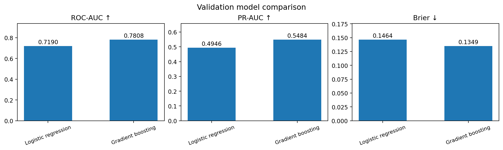
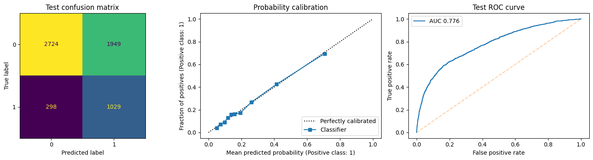
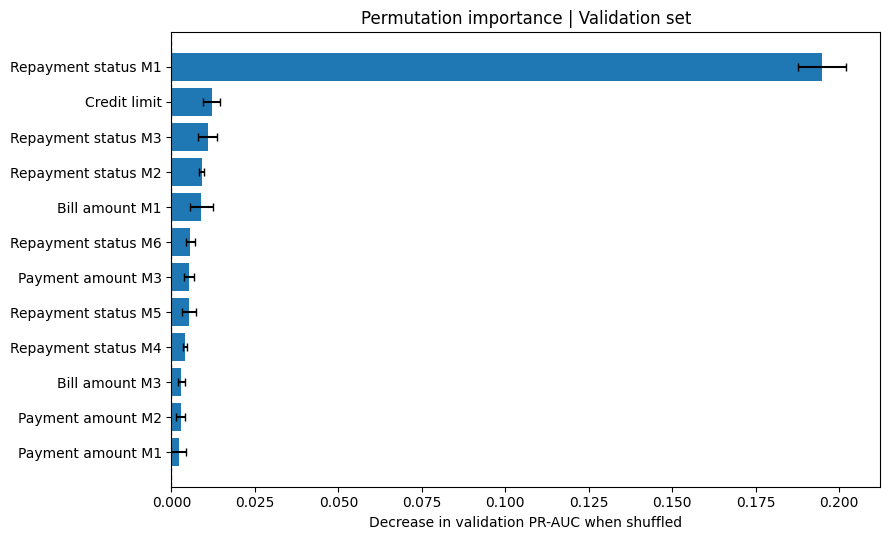
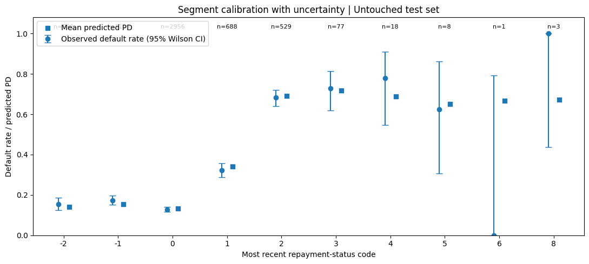
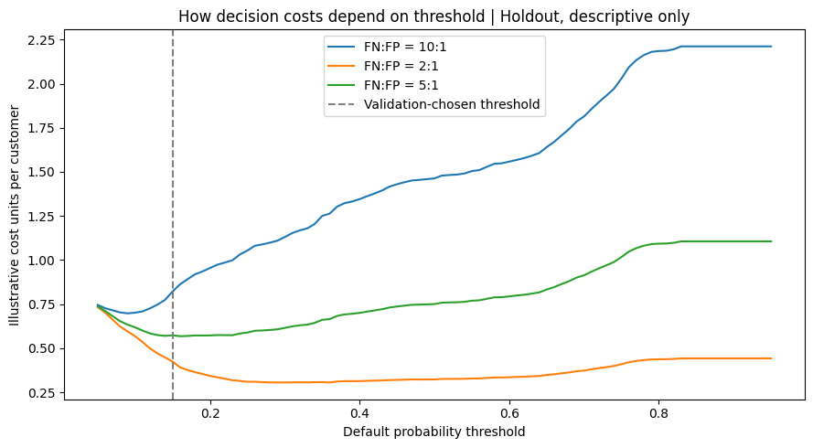

# Credit Default Prediction & Risk Analysis

**Python · Machine learning · Probability of default · Credit risk · Model calibration**

An educational, reproducible credit-risk case study using the [UCI Default of Credit Card Clients dataset](https://archive.ics.uci.edu/dataset/350/default+of+credit+card+clients). Predicts the following month's repayment default using 19 credit-limit, repayment-status, billing and payment variables. Compares an interpretable logistic regression with gradient boosting, then examines model performance, predictive risk drivers, calibration, sampling uncertainty and illustrative credit-decision costs.

> **Scope:** Historic Taiwan credit-card customers from 2005. This project is not a modern bank PD model, a lending recommendation, or a production underwriting policy. The dataset is downloaded from UCI when the notebook runs and is not redistributed.

## Results at a glance

| Metric | Logistic regression (validation) | Gradient boosting (validation) |
| --- | ---: | ---: |
| ROC-AUC ↑ | 0.7190 | **0.7808** |
| PR-AUC ↑ | 0.4946 | **0.5484** |
| Brier score ↓ | 0.1464 | **0.1349** |

**Selected model:** gradient boosting, selected using *validation PR-AUC*.

**Untouched test sample:** 6,000 customers (1,327 observed defaults).

| Holdout metric | Estimate | Stratified bootstrap 95% interval |
| --- | ---: | ---: |
| ROC-AUC | **0.7763** | 0.7623–0.7916 |
| PR-AUC | **0.5512** | 0.5251–0.5773 |
| Brier score | **0.1355** | 0.1315–0.1394 |

The initial classification threshold was chosen **on validation only**, under an assumed false-negative:false-positive cost ratio of 5:1. The test confusion matrix at that threshold shows 1,029 true positives, 298 false negatives, 1,949 false positives and 2,724 true negatives. This favors detecting defaults, but flags many customers who do not default. Cost ratios are hypothetical educational units.

### Findings
1. **Most recent repayment status** dominates validation permutation importance (roughly 0.195 reduction in PR-AUC when shuffled). The model also uses credit limit and previous repayment history.
2. Partial dependence indicates a sharp increase in estimated default risk at a **two-month repayment delay**, but these are predictive associations, not causal effects.
3. Broad customer segments show reasonably close observed and mean predicted PD. **Severe repayment-status categories are sparse:** in the test set, status 6 has 1 observation, and status 8 has 3. Extreme observed rates in these groups are not reliable evidence of miscalibration.
4. The preferred decision threshold changes materially with assumed false-negative and false-positive costs. The holdout cost curves are **descriptive only**, not a source for reselecting the deployment threshold.

## Research report

[**Read the PDF research report**](reports/Credit_Risk_Research_Report.pdf)

## Files

| Location | Contents |
| --- | --- |
| `notebooks/credit_risk_modelling.ipynb` | End-to-end Colab notebook, phases 1–3 |
| `figures/` | Six user-provided Colab charts and one validation comparison reconstructed from reported metrics |
| `reports/Credit_Risk_Research_Report.pdf` | Findings, methodology, scenario analysis and limitations |
| `data/README.md` | How to export CSV tables from Colab; no raw borrower records bundled |
| `sources/SOURCES.md` | UCI dataset attribution and methodology notes |
| `requirements.txt` | Python dependencies |

## Run in Google Colab

1. Open [Google Colab](https://colab.research.google.com/) and upload `notebooks/credit_risk_modelling.ipynb`.
2. Choose **Runtime → Run all**. Internet access is required to download the dataset through `ucimlrepo`.
3. Review model comparison, holdout results, risk-driver plots, bootstrap intervals and cost curves.
4. Download the generated figures and CSVs from Colab if you want fresh programmatically exported assets.

The repository notebook is a **clean, unexecuted template**. Numerical results and chart images in this repository are transcribed from the author's executed Colab run shared on 20 November 2026. The project package was inspected for code structure and syntax, but the complete external-data pipeline was not independently rerun in the packaging environment. Historical market/data-library revisions can affect later reproductions.

## Model governance and limitations

- **Split:** stratified training / validation / holdout test at 60% / 20% / 20%. Preprocessing is fitted inside each model pipeline.
- **Selection:** model and illustrative decision threshold selected from validation; the test set is reserved for final estimates. Later test plots are diagnostic, not used for retuning.
- **Bootstrap:** 400 stratified resamples of test observations quantify sampling uncertainty; not uncertainty from time, population, or data drift.
- **Special repayment codes:** Official UCI definitions describe −1 as paying duly and positive codes as delay months; −2 and 0 appear in the data and are treated as special codes with uncertain semantic meaning, not as ordered delay lengths.
- **Excluded demographic features:** Age, sex and education are deliberately excluded, but this does **not** establish fairness or eliminate proxy discrimination.
- **Concept of default:** Next-month credit-card payment default, not a full IFRS 9 / Basel annualized PD or loan-loss model.
- **Decision economics:** Hypothetical cost ratios are not actual LGD, EAD, credit approval profit or capital charges.
- **Interpretability:** Permutation importance is affected by correlated predictors; partial dependence does not identify causes and can generate implausible feature combinations.

## Further work

Add a temporal/out-of-time validation dataset, compare calibration over time, audit subgroup fairness under appropriate governance, consider true EAD/LGD-based losses, and build a stable inference/retraining pipeline.

**Educational research only. No real customer credit decisions should be based on this model.**
